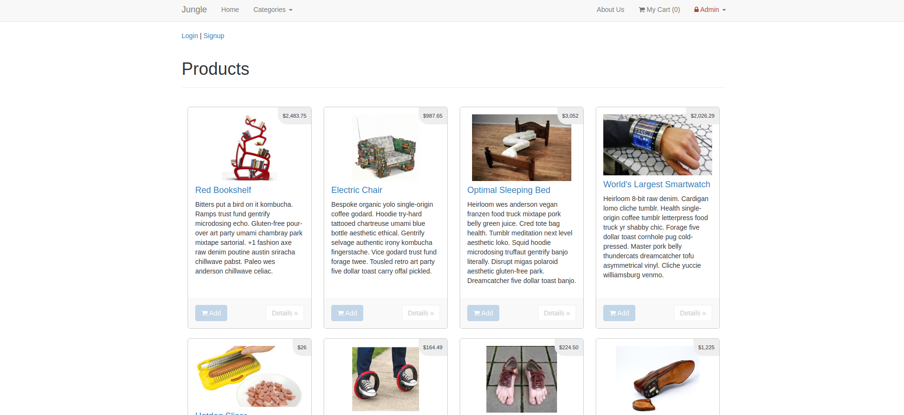
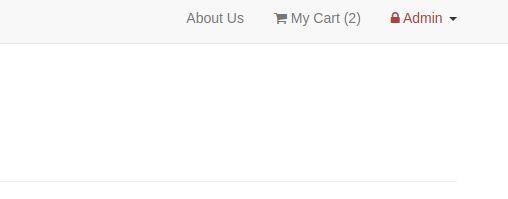
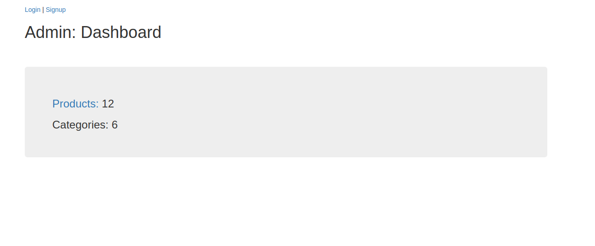
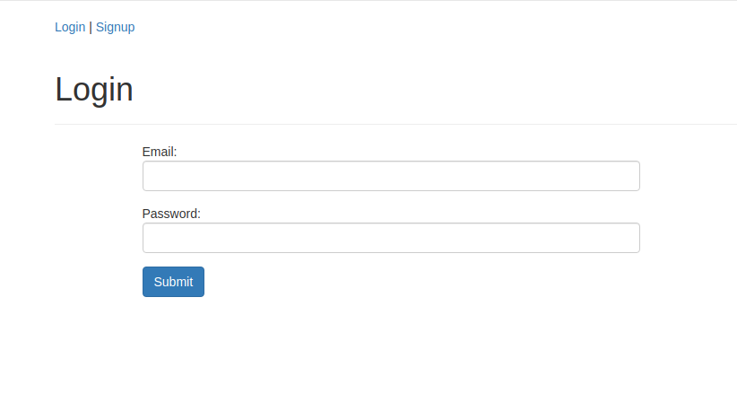
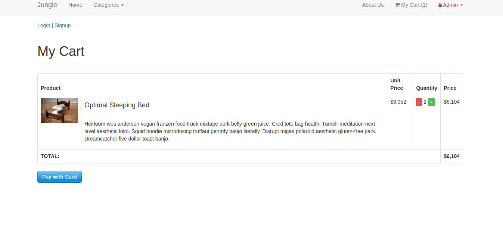
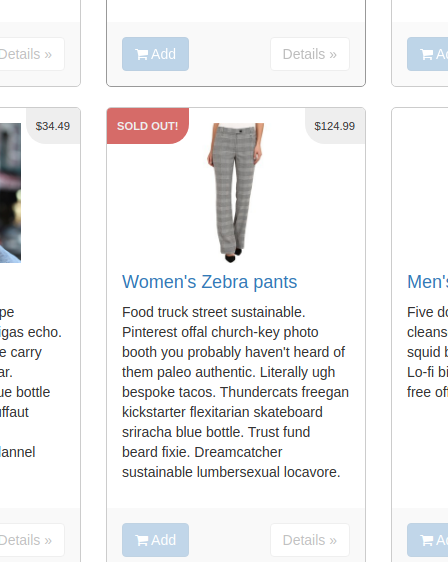

# Jungle — Rails e-commerce application

A **historical Rails learning project** exploring storefront and administration workflows, including product browsing, authentication, shopping carts and checkout integration.

> Built with an older Rails stack. This repository is retained as a portfolio example, not a production-ready shop or actively maintained service.

## Features in the codebase

- Product catalogue, product details and cart interactions
- Authentication and account registration
- Administration pages for products and categories
- Stripe payment integration intended for testing/development
- RSpec/Capybara test structure, including cart and product feature specs

## Stack

Ruby (the `Gemfile` specifies **2.3.5**), Rails **4.2.6**, PostgreSQL, server-rendered views, Bootstrap Sass and Stripe.

## Screenshots

| Storefront | Cart |
| --- | --- |
|  |  |

| Admin | Registration |
| --- | --- |
|  |  |

| Purchase flow | Sold-out state |
| --- | --- |
|  |  |

## Running locally

The project depends on legacy Ruby and Rails versions, so it may require an isolated environment with compatible versions of dependencies. It has **not been verified against current Ruby or Rails**.

1. Install the Ruby version specified by the `Gemfile` and compatible Bundler tooling.
2. Run `bundle install`.
3. Configure a local PostgreSQL database and the required Rails configuration/environment values. Check the files in `config/` for supported configuration.
4. Initialize a **disposable local database** with the project's available rake tasks; resetting a database can destroy existing data.
5. Start the application with `bin/rails s`.

Payment processing requires your own Stripe **test** credentials. Do not use live payment credentials, deploy this project as-is, or treat historical sample accounts as secure defaults.

## Project status

This is a historical educational project. Dependencies, security practices, and configuration would need substantial updates before any modern deployment. Screenshots above are stored in this repository.
